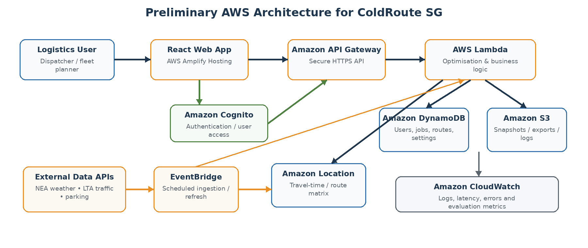

# Preliminary proposal

> **ColdRoute SG: weather-, traffic- and parking-aware cold-chain delivery optimisation**
> CS5224 Cloud Computing, group project preliminary report. Group 36. Submitted 28 September 2026.
>
> This is the submitted text, converted to Markdown and otherwise unchanged. For where the project stands now, see [project-brief.md](project-brief.md) and [roadmap.md](roadmap.md).

## Motivation and Business Case

Last-mile delivery planning is difficult because route quality changes with operational conditions. A route that is shortest under normal conditions may become inefficient when congestion increases, heavy rain slows travel or unloading, or parking near a customer becomes scarce. These issues are more consequential for cold-chain deliveries because additional delay can increase the time that temperature-sensitive goods spend in transit or during unloading.

ColdRoute SG is proposed as a cloud-based Software-as-a-Service (SaaS) platform for Singapore logistics operators. It recommends the sequence in which deliveries should be served by combining travel time with live traffic, short-term weather, parking availability, delivery time windows and cold-chain urgency. The prototype is therefore not simply a map or route viewer; its main value is the decision layer that converts heterogeneous real-time data into a risk-aware delivery sequence.

Target users include SMEs and delivery teams involved in refrigerated food distribution, groceries, pharmaceuticals, healthcare supplies and other temperature-sensitive goods. To keep the prototype implementable, the initial scope is one vehicle leaving one depot and serving approximately 5–15 delivery locations within Singapore.

## Proposed Data and Differentiation

Singapore is a suitable testbed because relevant public datasets are available. NEA’s 2-hour weather forecast is published through data.gov.sg and is updated every 30 minutes. LTA DataMall exposes real-time datasets including traffic incidents, traffic speed bands, estimated expressway travel times and carpark availability. These feeds can be combined with user-entered delivery information such as address, time window, service duration and cold-chain priority.

| **Input/Signal** | **How ColdRoute SG uses it** |
|:---|:---|
| Traffic | Adjust travel-time or congestion penalty between stops. |
| Weather | Increase risk for stops/areas affected by heavy rain or thunderstorms. |
| Parking | Penalise destinations with low nearby carpark availability or likely loading difficulty. |
| Delivery constraints | Respect time windows, service duration and business priority. |
| Cold-chain sensitivity | Prioritise goods whose prolonged transit or unloading creates higher exposure risk. |

## Business Model

The prototype will be free for project demonstration and user testing. A commercial version could use a B2B subscription model based on fleet size or number of route optimisations. A basic tier could support smaller delivery teams, while higher tiers could add multi-vehicle planning, historical analytics, API integration and live temperature telemetry. The value proposition is lower driver time, fewer late deliveries, better utilisation and reduced exposure of cold-chain goods to avoidable delay.

## Cloud Service and Preliminary Architecture

The planned user journey is: (1) sign in, (2) create a delivery run, (3) enter the depot and customer stops, (4) specify delivery windows and cold-chain priority, (5) retrieve the latest traffic/weather/parking context, (6) run the optimiser, and (7) inspect the recommended sequence, ETA, warnings and route rationale.

*Figure 1. Proposed serverless AWS architecture for the ColdRoute SG prototype.*

A serverless design is proposed because requests are intermittent and the team should spend more effort on the optimisation logic than on operating servers. AWS reference architectures similarly use a static/web front end, Amazon Cognito for user authentication, API Gateway and Lambda for the logic layer, and DynamoDB for application data. Amplify Hosting supports React single-page applications and Git-based deployment.

| **Component** | **Role in prototype** | **AWS Educate alternative** |
|:---|:---|:---|
| AWS Amplify Hosting | Host React web interface and continuous deployment. | Use S3 static hosting or an EC2 web server if Amplify is restricted. |
| Amazon Cognito | User registration, login and access tokens. | For a closed demo, use simple application login only if Cognito is unavailable. |
| API Gateway + Lambda | Secure API and serverless optimisation/business logic. | Run FastAPI/Flask on EC2 if Lambda/API Gateway is unavailable. |
| DynamoDB | Delivery jobs, users, optimisation results and settings. | RDS or a lightweight database on EC2 for prototype. |
| S3 | Historical snapshots, exports and evaluation artefacts. | Core storage service; retain if permitted. |
| EventBridge | Schedule periodic refresh of external conditions. | Refresh on demand from backend if scheduled events are restricted. |
| Amazon Location Service | Travel-time/distance matrix used as an input to our own optimiser. | Alternative routing/geocoding source if the account does not enable the service. |
| CloudWatch | Logs, latency, errors and evaluation metrics. | Application logs on EC2 if needed. |

## Optimisation Method

ColdRoute SG will implement its own delivery-scoring and optimisation layer. A travel-time matrix provides the baseline cost between stops; the algorithm then adds penalties representing business and operational risk. Amazon Location Service can calculate route matrices containing travel duration and distance and supports traffic-aware routing parameters, but it will not determine the final delivery order. We defined the route cost as such:

**Route Cost = αT + βL + γW + δP + εC**

where T is travel time, L is lateness/time-window penalty, W is weather risk, P is parking risk and C is cold-chain exposure risk. The weights allow the same system to behave differently for ordinary parcels versus high-priority refrigerated goods.

A feasible first route can be generated using an earliest-deadline or nearest-neighbour heuristic. The sequence can then be improved with 2-opt/local search. This is intentionally manageable for 5–15 stops while still allowing an evaluation against a conventional shortest-time baseline. If time permits, a stronger heuristic such as simulated annealing or Google OR-Tools can be added as an experimental extension.

## Implementation Plan

| **Phase** | **Planned work** | **Output** |
|----|----|----|
| 1. Data & baseline | Connect to NEA/LTA feeds; geocode delivery locations; construct travel-time matrix; implement shortest-time baseline. | Working data pipeline and baseline route. |
| 2\. Risk-aware optimiser | Create weather, traffic, parking, time-window and cold-chain penalties; tune weights on scenarios. | Custom risk-aware route recommendation. |
| 3\. AWS backend | Deploy API/compute; persist jobs/results; configure authentication and logging. | Cloud-hosted backend. |
| 4\. Web interface | React form/import, route map, ETA table, warnings, explanation and baseline comparison. | End-to-end SaaS prototype. |
| 5\. Test & evaluate | Scenario tests, load/performance tests, cost tracking and usability study. | Evidence for final report and presentation. |

**Core prototype features**

- Delivery-run creation with depot, stops, time windows, service duration and cold-chain priority.

- Map and ordered-stop view with ETA and operational-risk indicators.

- Baseline versus risk-aware route comparison.

- Explainable rationale (e.g., “Stop B moved earlier due to narrow time window and weather risk”).

- Saved optimisation runs for evaluation and demonstration.

## Key Assumptions and Scope

The preliminary prototype is restricted to Singapore, one depot and one vehicle per optimisation run. Delivery demand is known before planning; the system recommends routes rather than providing safety-critical turn-by-turn navigation. Cold-chain risk is initially a configurable model rather than live temperature telemetry. A future extension could integrate IoT temperature sensors and dynamic re-optimisation while a vehicle is en route.

## Evaluation Plan

### System evaluation

The risk-aware optimiser will be compared with a shortest-time baseline across controlled delivery scenarios. Scenarios will vary traffic congestion, rainfall, parking availability, delivery windows and cold-chain priority. The purpose is to show not only that the software runs, but that its recommendations change in a rational and measurable way when operational conditions change.

| **Evaluation dimension** | **Measures** |
|:---|:---|
| Route quality | Total travel time and distance; late deliveries; average lateness; weighted route cost. |
| Cold-chain / operational risk | High-risk weather exposure; parking-risk exposure; cold-chain risk score; number of priority deliveries served within target windows. |
| System performance | Optimisation time for 5/10/15 stops; API latency; p50/p95 response time; error rate; concurrent requests. |
| Cloud economics | Lambda/API/storage usage and estimated cost per optimisation; projected monthly cost under example usage; comparison with on-premise hosting. |

### User evaluation

Approximately 8–12 users will complete a short set of tasks: create a delivery run, identify the highest-risk stop, generate a route, explain why it differs from the baseline, and modify a constraint before rerunning. Where possible, participants with logistics or operational-planning familiarity will be included.

Measures will include task completion, task time, errors, perceived usefulness, ease of use, confidence in understanding the recommendation, and a short Likert-scale usability survey or System Usability Scale. Open-ended feedback will identify which explanations and visual elements users find useful or confusing.

## Conclusion

ColdRoute SG provides a focused cloud-computing project with a clear business problem, multiple live data sources and an independently implemented decision layer. Its contribution is to combine traffic, weather, parking and delivery constraints into an explainable recommendation for cold-chain logistics. The proposed AWS architecture supports an end-to-end SaaS prototype while remaining modular enough for AWS Educate restrictions. The final project can be evaluated on algorithmic quality, cloud performance/cost and actual user usability, matching the project brief’s emphasis on clarity, implementation quality and evaluation.
