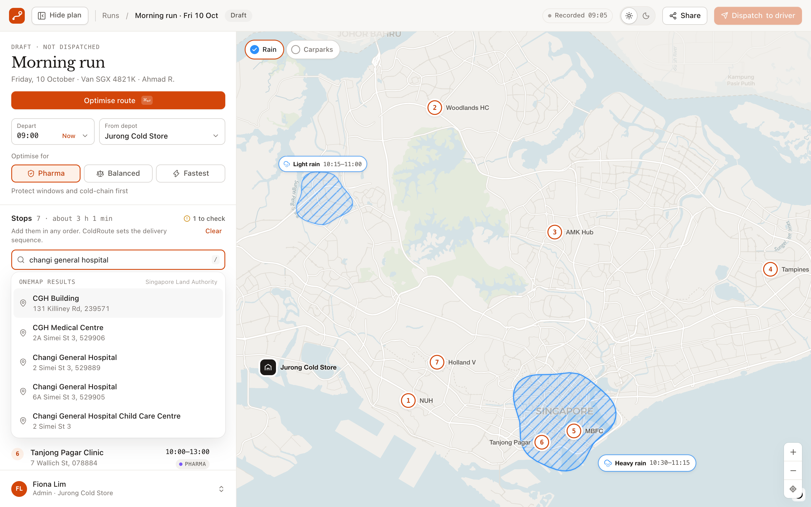
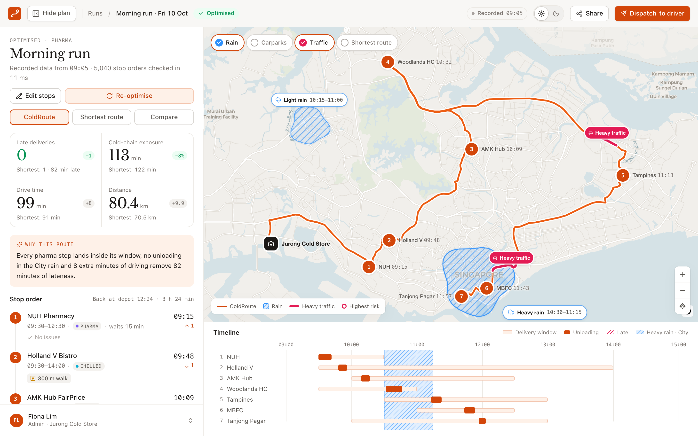
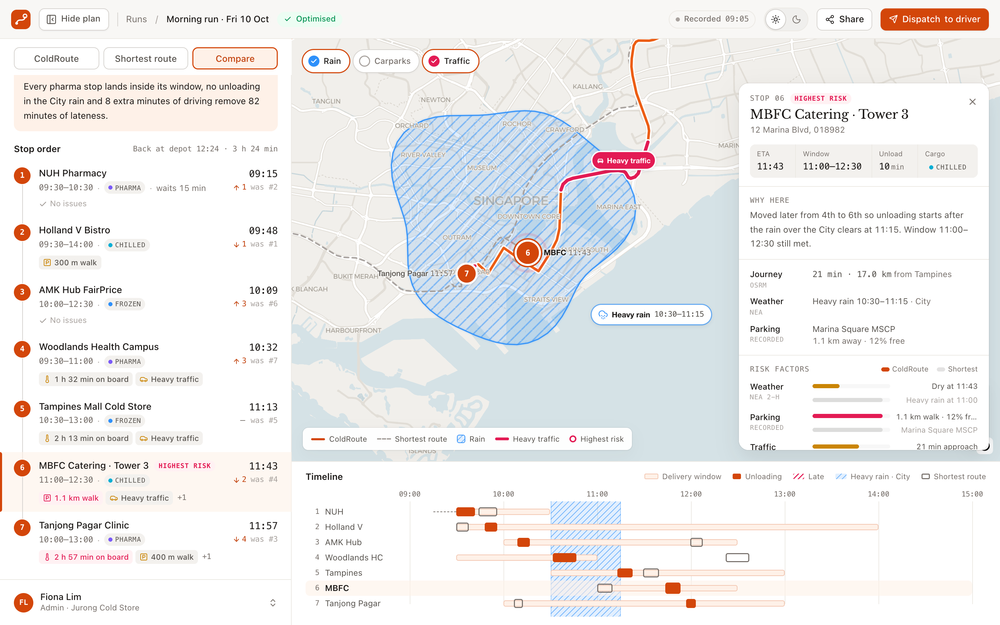
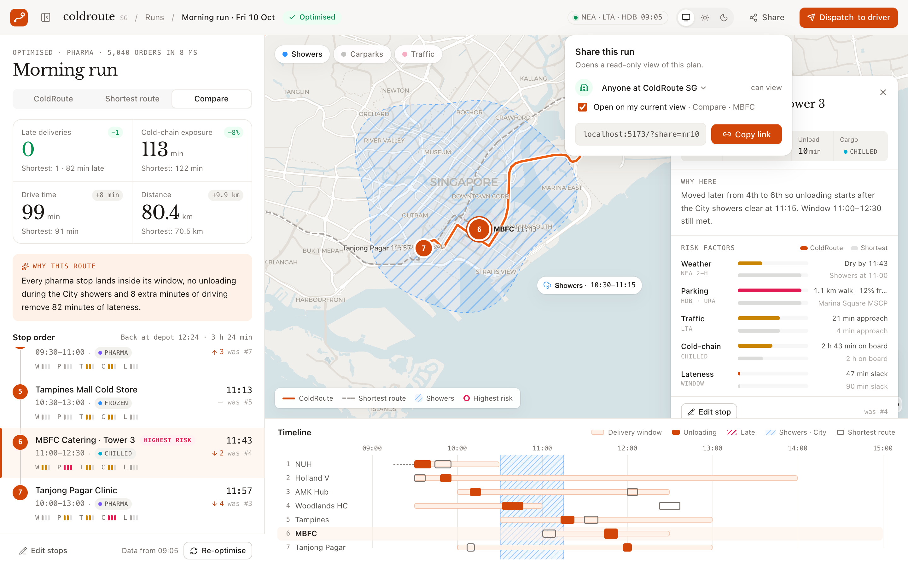
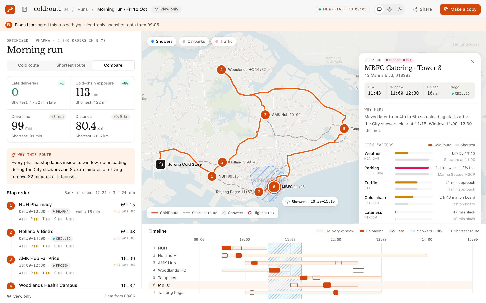
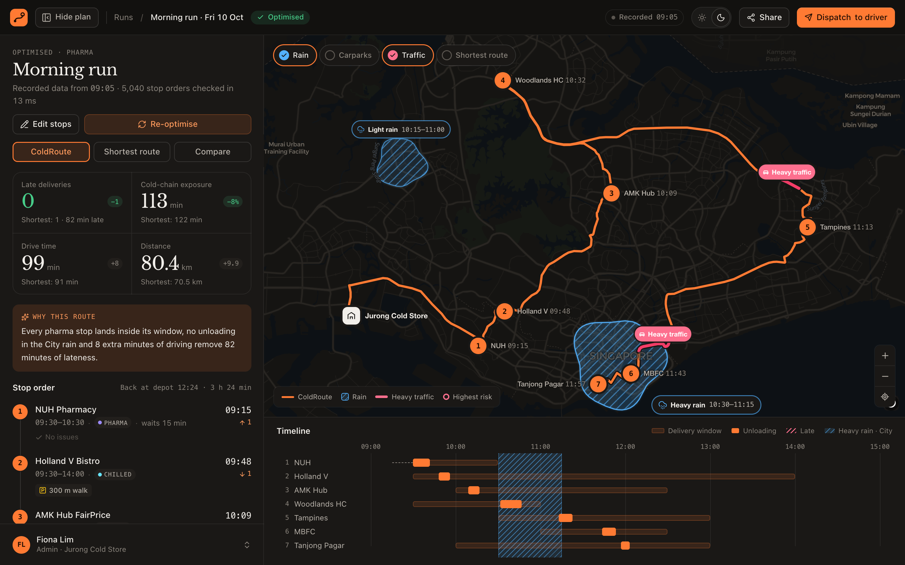
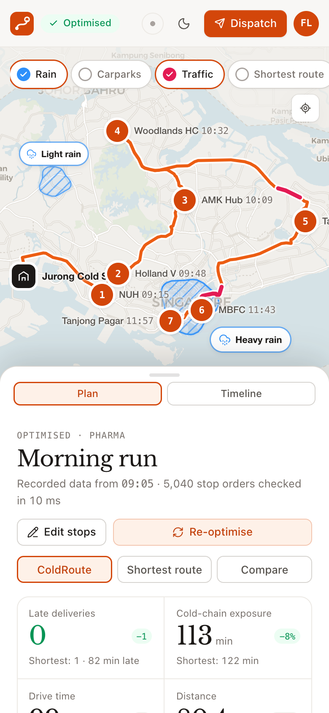
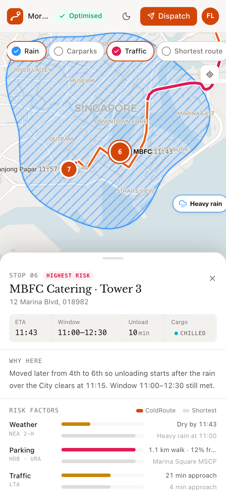
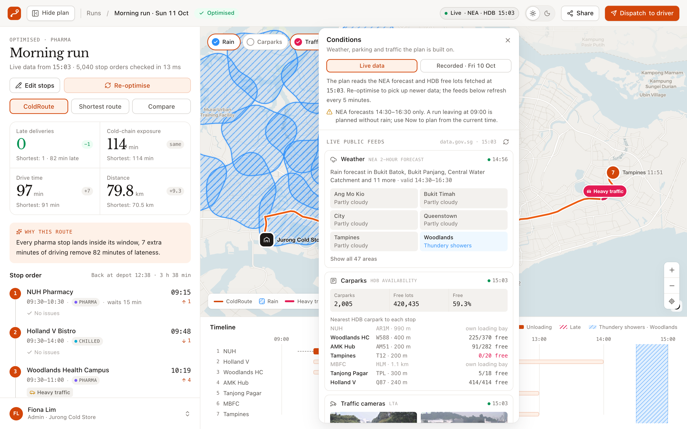
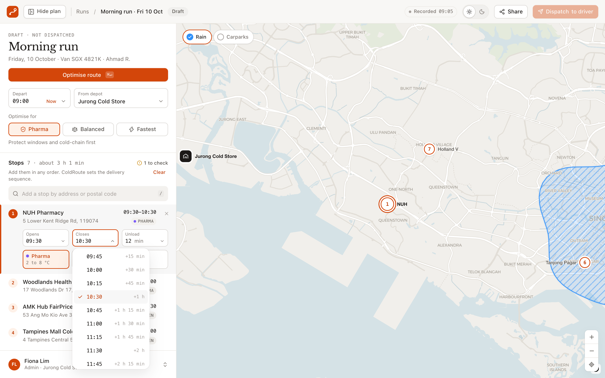

# ColdRoute SG — dispatcher console (frontend)

A single-screen dispatcher console for planning one cold-chain van run in Singapore. The flow is:
**draft the run → optimise → read why → dispatch**.

## Screenshots

| Draft: input and OneMap search | Optimised: results |
| --- | --- |
|  |  |
| **Compare view and stop card** | **Share** |
|  |  |
| **Opened from a share link (view only)** | **Dark mode** |
|  |  |
| **Phone: results and stop card** | **Live data: the Conditions panel** |
|   |  |
| **Editing a stop: pick the closing time** | |
|  | |

## Run it

```bash
npm install
npm run dev        # http://localhost:5173
npm run build      # type-check + production bundle in dist/
npm run preview    # serve dist/ on http://localhost:4173
```

No API key is needed. Basemap tiles come from CARTO (Positron and Dark Matter), repainted with the theme's land, water and park colours at load time.

## What the demo shows

| Area | What it does |
| --- | --- |
| Data mode | The pill in the top bar shows what the plan is built on: **Recorded 09:05** (the rainy sample morning, the default, so the demo case never changes) or **Live · NEA · HDB 13:49**. Click it for the **Conditions** panel: the Live data / Recorded switch, then the live public feeds with their own update times: the NEA 2-hour forecast for all 47 areas, HDB carpark availability with the nearest carpark to each stop, and the LTA traffic cameras nearest the stops. Feeds refresh every 5 minutes while the panel is open or Live is on. Switching mode on a finished plan re-plans it. `?data=live` forces Live for one visit. |
| Input panel | Departure time (pick a slot, type it, or **Now**), depot, **Optimise for** (Pharma, Balanced, Fastest), address search on **OneMap** (any building, street or postal code; the sample customers show when the box is empty), **Load sample** and **Clear**, inline editing of the time window (pick from 15-minute slots; closing times show the window length, "+2 h"), unloading time (5 to 60 min, or **Custom…**) and cargo class, and an ambiguous-address resolver. Stops can be added in any order: the list is a set of orders, and the optimiser decides the sequence. A new stop opens with a four-hour window from the departure, chilled cargo and 10 min to unload, ready to edit. The run is kept across reloads, up to 15 stops. **Optimise route** sits right under the run title. |
| Optimising | A short, staged progress list for the five data sources takes the place of the Optimise button, then the result appears. `⌘↵` runs it from anywhere. |
| Results panel | **Re-optimise** and **Edit stops** sit under the title, with the data the plan used ("Live data from 13:49"). Then four KPIs, each compared with the shortest route, a red alert listing any late delivery, a plain-language "Why this route" summary, and the stop order. Each stop lists only what needs attention, in words: "Unloads in rain", "300 m walk", "Heavy traffic", "2 h 57 min on board", "12 min spare". Red means high risk. The whole panel scrolls as one, with the view switch pinned to the top. |
| Map | Locked to Singapore: you can't pan or zoom out past the island, and Johor and the Riau islands are dimmed. Numbered stops, a route drawn on real roads, hatched rain cells that drift slowly, and heavy-traffic stretches marked on the route. Recorded mode has two cells (light rain in the west, heavy rain over the City); Live mode draws one per NEA area that forecasts rain, and labels only those over the run's stops. Optional layers show carparks with walking links and the shortest route as a ghost. The highest-risk stop pulses. |
| Stop card | Click any stop: ETA, window, unloading time, a "Why here" explanation, the details behind it (Journey from the previous stop, NEA weather, the carpark used and its free lots, the nearest LTA camera in Live mode), and every risk factor compared with the shortest route. |
| Timeline | Delivery windows, unloading blocks, waits, lateness and the rain periods over this run's stops on one time axis. In Compare view it also shows the shortest route as ghost blocks. |
| Share | **Share** opens a small popover under the button. It has three parts: who can open the link (anyone at ColdRoute SG, or anyone with the link; both can view only), an option to open the link on your current view (e.g. Compare · MBFC), and **Copy link**. |
| Shared view | Opening a `?share=` link shows a read-only snapshot with a "shared with you" banner and a **View only** status. Edit, re-optimise and dispatch are hidden. **Make a copy** turns it into your own editable run. |
| Account (mock) | The bottom of the panel shows who is signed in (Fiona Lim, Admin). Click it for the account menu and **Sign out**. Signed out, it offers **Sign in**, which opens a demo account picker. **Dispatch to driver** asks you to sign in first, then sends. On phones, and when the panel is hidden, the avatar moves to the top bar. Nothing leaves the browser: the user is kept in `localStorage`. |

Three views: **ColdRoute**, **Shortest route**, and **Compare**. Switching views redraws the map, list and timeline.

## Layouts

| Screen | Layout |
| --- | --- |
| Desktop (≥ 768 px) | Panel on the left, map and timeline on the right. The panel toggle sits next to the logo, in the same place whether the panel is open or hidden, so one click hides it and the next brings it back. `[` does the same. Drag the panel edge to resize it (340–600 px), double-click the edge to reset, or drag it past the minimum to hide. Width and visibility are saved in `localStorage`. The map re-frames the run whenever its size changes, unless you have panned or zoomed it yourself. |
| Phone (< 768 px) | The map fills the screen and the panel moves into a bottom sheet with three heights (peek, half, full). Drag or flick the grabber, or tap it to step up. After optimising, the sheet has **Plan** and **Timeline** tabs. Tapping a stop shows its card in the sheet, raised to half height. The top bar keeps the logo, the status, a light/dark button and the main action. |

Both layouts render the same components. `App.tsx` picks the arrangement with `useMediaQuery`, and smaller differences use Tailwind's `max-md:` variants.

## Conventions

The full rules are in [`AGENTS.md`](AGENTS.md); read it before changing the UI. AI coding agents pick it up automatically. In short:

- **Tokens only.** Colours, radii and shadows come from `index.css` and `lib/themes.ts`, and every colour means something (orange = action, green = better, amber = medium risk, rose = late or high risk, blue = rain).
- **One solid primary per screen.** Run actions sit in the top bar, plan actions at the top of the panel, and the account at the bottom.
- **One switch style.** Any choice between 2 and 4 options uses `Segmented`: outlined buttons, the chosen one filled.
- **Pick, don't type.** Times and durations use `TimePicker` and `MinutesPicker`; typing is a shortcut.
- **Same type scale everywhere.** Serif for titles and big numbers, `num` for times and distances, sentence-case copy in plain words.
- **Check before a PR.** Light and dark, panel widths 340 and 600, a 390 px phone, and `npm run build`.

## Button hierarchy

One solid primary button per screen, so the next step is always obvious.

| State | Solid primary | Supporting actions |
| --- | --- | --- |
| Draft | **Optimise route**, under the run title | **Dispatch to driver** is shown in the top bar but stays disabled until there is a plan |
| Optimised | **Dispatch to driver**, top right | **Re-optimise** is a tonal (tinted) primary for the panel; **Edit stops** is a compact secondary; **Share** is secondary |
| Shared view | **Make a copy** | Nothing else can change the run |

Actions live at the top: the top bar for the run, the top of the panel for the plan. The bottom of the panel is for the account.

## Design system

The brand colour is **Safety Orange** on warm paper, the high-vis orange used across logistics. Other colours only appear where they carry meaning:

| Role | Light | Used for |
| --- | --- | --- |
| Brand | `#d3460a` | Primary buttons, stop numbers, unloading blocks, selection. 4.52:1 contrast with white text (WCAG AA). |
| Route | `#ec5d13` | The ColdRoute line on the map. Brighter than the brand colour so it reads on map tiles. |
| Green (`ok`) | `#079455` | Improvements vs the shortest route, on time, live data |
| Amber (`warn`) | `#ca8504` | Medium risk, addresses that need review. Yellow-amber, so it is not confused with the brand orange. |
| Rose (`bad`) | `#e31b54` | Late, highest-risk stop, slow traffic. Rose rather than red, for the same reason. |
| Blue (`rain`) | `#2e90fa` | Rain cells on the map and in the timeline |
| Cargo dots | violet, blue, cyan | PHARMA, FROZEN, CHILLED |

Dark mode (**Night Shift**) uses warm charcoal with a brighter orange (`#ff7a33`) and dark text on orange buttons.

Appearance follows the operating system by default. The **System / Light / Dark** switch in the top bar overrides it, and the choice is saved. On phones it is a single light/dark button. For demos and screenshots, `?theme=dark` forces a theme for one visit, `?data=live` forces live data, and `?state=results` opens straight on the optimised plan.

Both themes live in `src/lib/themes.ts`, with the UI tokens and the matching map palette in one place. `applyTheme()` writes the tokens to `<html>` as CSS variables before first paint. Components only use semantic utilities (`bg-panel`, `text-fg-2`, `bg-brand`, `text-ok`, `bg-bad-soft`, …). The other palettes explored earlier (teal, glacier blue, indigo, mono) are in commit `94abb12`.

## Data and algorithm

- `src/data/sg-mask.json` is the area outside Singapore's national boundary (OpenStreetMap relation 536780, simplified). The map dims it. Run `npm run data:sg-mask` to refresh it.
- `src/data/osrm.json` is a snapshot of a real driving-time matrix and per-leg road geometry from the public OSRM server. It covers the depot, the 7 sample stops and the 3 sample customers, so the demo never waits on the network. Run `npm run data:osrm` to refresh it.
- Any other stop comes from **OneMap** search (`src/lib/places.ts`, no token, called from the browser). It takes its nearest NEA forecast area (`src/data/nea-areas.json`, `npm run data:nea-areas`) and nearest HDB carpark within 600 m, with free lots assumed until Live data reads them. Traffic is a rough guess (busier near the CBD).
- `src/lib/roads.ts` gets real drive times for such stops from the OSRM table service as they are added (one call for the run), and the road geometry for the two plans after optimising (one route call each). If OSRM is down, times fall back to a road-factor estimate, legs are straight lines, and the plan says so.
- `src/lib/optimizer.ts` enumerates every stop order: 5,040 for 7 stops, about 60 ms for 8. It returns two plans. The **baseline** minimises drive time only. The **recommended** plan minimises a weighted cost of drive time, weather, parking, traffic, cold-chain exposure and lateness, using the profile's weights.
- `src/lib/explain.ts` turns the difference between the two plans into the summary and "Why here" text.
- **Recorded mode** uses the rainy morning in `src/data/sample.ts` (sample data, recorded at 09:05 on Fri 10 Oct). It never changes, so the demo case is always the same.
- **Live mode** reads data.gov.sg straight from the browser (`src/lib/live.ts`; no key, CORS is open): the NEA 2-hour forecast, HDB carpark availability and LTA traffic images. `src/lib/conditions.ts` turns them into what the optimiser needs: one rain cell per NEA area forecasting rain, over the forecast period; each stop's nearest NEA area; and the nearest HDB carpark if it is within 600 m (further away, the stop keeps its own loading bay). The availability feed has no coordinates, so `src/data/hdb-carparks.json` holds them (data.gov.sg HDB Carpark Information, SVY21 converted to WGS84). Run `npm run data:hdb-carparks` to refresh it. If the forecast does not load, the plan falls back to the recorded morning and says so.
- Traffic is still an estimate in both modes: live speed bands need an LTA DataMall key.
- The plan keeps the data it was built on, so the feeds refreshing in the background never change a finished plan. **Re-optimise** reads them again.

## Structure

```text
src/
├─ App.tsx                 state machine (draft → optimising → optimised), layout, theme, sharing, account, shortcuts
├─ index.css               design tokens and themes
├─ components/
│  ├─ Shell.tsx            top bar, logo, panel toggle, theme switch
│  ├─ ConditionsPanel.tsx  data mode switch and the live public feeds
│  ├─ PanelHandle.tsx      resize handle for the desktop panel
│  ├─ BottomSheet.tsx      phone bottom sheet
│  ├─ StopsEditor.tsx      input panel and optimising progress
│  ├─ Pickers.tsx          time and minutes pickers (pick a slot or type)
│  ├─ ResultsPanel.tsx     plan actions, KPIs, explanation, stop order with watch-outs
│  ├─ MapView.tsx          MapLibre map, overlays, markers, layer chips
│  ├─ StopCard.tsx         stop detail card (on the map, or in the phone sheet)
│  ├─ Timeline.tsx         time-axis view
│  ├─ SharePopover.tsx     share popover: link access, current view, copy
│  ├─ Account.tsx          mock sign-in, panel account bar, top-bar avatar
│  └─ ui.tsx               buttons, segmented control, tags
├─ lib/                    optimizer, roads (OSRM), places (OneMap), explanations, live feeds, conditions, geo, themes, hooks, time helpers, types
└─ data/                   sample run, OSRM snapshot, HDB carpark coordinates, NEA areas, Singapore mask
```

## Notes

- MapLibre v6 ships an ES-module worker. `MapView.tsx` sets its URL explicitly. `vite.config.ts` emits it as `.js`, so static hosts such as Amplify serve it with a JavaScript MIME type.
- MapLibre's stylesheet is unlayered, so it overrides Tailwind's layered utilities. That is why the map container is positioned with an inline style.
- In MapLibre, `easeTo({ padding })` changes the map's padding permanently, and `fitBounds` adds its own padding on top of that. So the stop-focus animation uses `offset` instead, and `fit()` clears any leftover padding first. Without this, the map zooms far out after you close a stop card.
- Recent Chrome versions return a Promise from `element.scrollTo()`. Never return its value from a React effect, or React treats it as a cleanup and crashes ("destroy is not a function").
