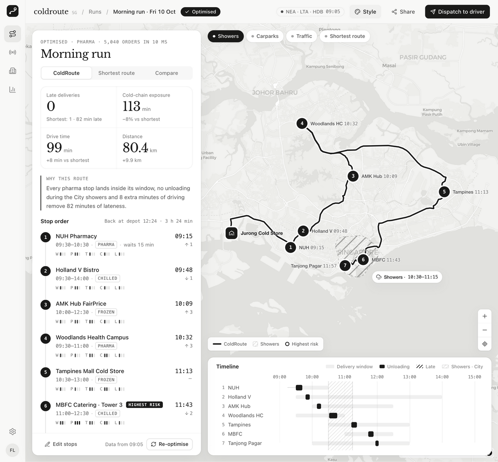

# ColdRoute SG — dispatcher console (frontend)

A single-screen dispatcher console for planning one cold-chain van run in Singapore. The flow is:
**draft the run → optimise → read why → dispatch**.

## Screenshots

| Draft: input | Optimised: results |
| --- | --- |
|  |  |
| **Compare view and stop card** | **Map-first and Dark** |
|  |   |

## Run it

```bash
npm install
npm run dev        # http://localhost:5173
npm run build      # type-check + production bundle in dist/
npm run preview    # serve dist/ on http://localhost:4173
```

No API key is needed. Basemap tiles come from CARTO (Positron and Dark Matter), repainted to monochrome at load time.

## What the demo shows

| Area | What it does |
| --- | --- |
| Input panel | Departure time, depot, optimisation profile (Pharma, Balanced, Fastest), address search with a mocked OneMap lookup, inline editing of time window, unloading time and cargo class, and an ambiguous-address resolver. |
| Optimising | A short, staged progress list for the five data sources, then the result. `⌘↵` runs it. |
| Results panel | Four KPIs, each compared with the shortest route. Also a plain-language "Why this route" summary and the stop order with W/P/T/C/L risk meters and how far each stop moved. |
| Map | Numbered stops, a route drawn on real roads, a hatched shower cell and carparks with walking links. Optional layers show slow road segments and the shortest route as a ghost. The highest-risk stop pulses. |
| Stop card | Click any stop: ETA, window, unloading time, a "Why here" explanation, and every risk factor compared with the shortest route. |
| Timeline | Delivery windows, unloading blocks, waits, lateness and the shower period on one time axis. In Compare view it also shows the shortest route as ghost blocks. |

Three views: **ColdRoute**, **Shortest route**, and **Compare**. Switching views redraws the map, list and timeline.

## Design system

The tokens follow the Manus palette: a warm off-white canvas, ink-black primary actions, hairline borders, a serif display face (Libre Baskerville) and tabular figures for every time and number. The only accent is an optional signal red for late and highest-risk items.

Use **Style** in the top bar to switch between four directions, or add `?style=` to the URL:

| `?style=` | Direction |
| --- | --- |
| *(none)* | Manus Paper: warm off-white, soft cards, serif titles |
| `editorial` | Pure white, hairlines, 2 px corners |
| `mapfirst` | Full-bleed map with floating panels |
| `dark` | Manus Dark, for night shifts and control rooms |

Each theme only swaps CSS variables (`src/index.css`). Components use the semantic utilities (`bg-panel`, `text-fg-2`, `border-line`, `bg-ink`, `rounded-panel`, …).

## Data and algorithm

- `src/data/osrm.json` is a snapshot of a real driving-time matrix and per-leg road geometry from the public OSRM server. It covers the depot, the 7 sample stops and the 3 address-book entries. Run `npm run data:osrm` to refresh it.
- `src/lib/optimizer.ts` enumerates every stop order: 5,040 for 7 stops, about 60 ms for 8. It returns two plans. The **baseline** minimises drive time only. The **recommended** plan minimises a weighted cost of drive time, weather, parking, traffic, cold-chain exposure and lateness, using the profile's weights.
- `src/lib/explain.ts` turns the difference between the two plans into the summary and "Why here" text.
- Weather, parking and traffic values are mocked in `src/data/sample.ts`. The shapes match the backend's `/api/data/*` responses, so moving to live data only changes where the values come from. The UI stays the same.

## Structure

```text
src/
├─ App.tsx                 state machine (draft → optimising → optimised), layouts, shortcuts
├─ index.css               design tokens and themes
├─ components/
│  ├─ Shell.tsx            nav rail, top bar, brand
│  ├─ StopsEditor.tsx      input panel and optimising progress
│  ├─ ResultsPanel.tsx     KPIs, explanation, stop order
│  ├─ MapView.tsx          MapLibre map, overlays, markers, layer chips
│  ├─ StopCard.tsx         stop detail card on the map
│  ├─ Timeline.tsx         time-axis view
│  ├─ StyleMenu.tsx        design direction switcher
│  └─ ui.tsx               buttons, segmented control, tags, meters
├─ lib/                    optimizer, explanations, time helpers, types
└─ data/                   sample run, OSRM snapshot
```

## Notes

- MapLibre v6 ships an ES-module worker. `MapView.tsx` sets its URL explicitly. `vite.config.ts` emits it as `.js`, so static hosts such as Amplify serve it with a JavaScript MIME type.
- MapLibre's stylesheet is unlayered, so it overrides Tailwind's layered utilities. That is why the map container is positioned with an inline style.
